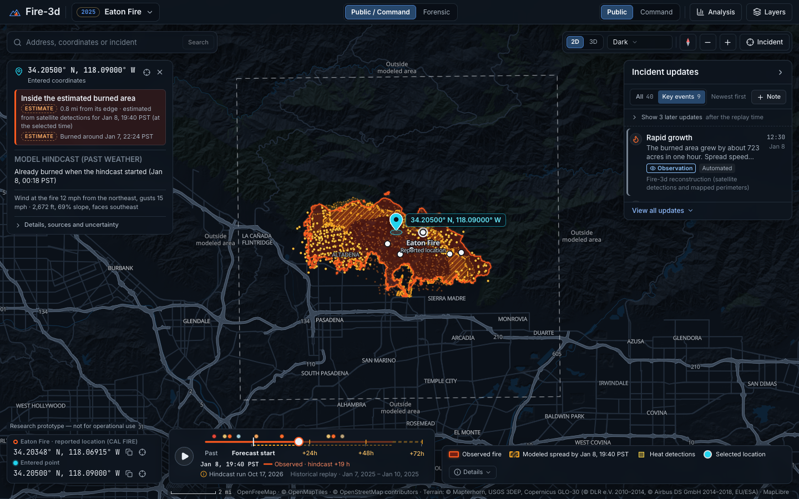
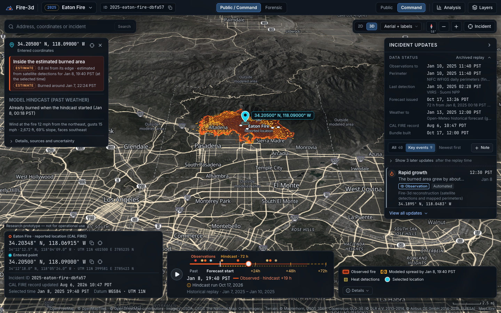
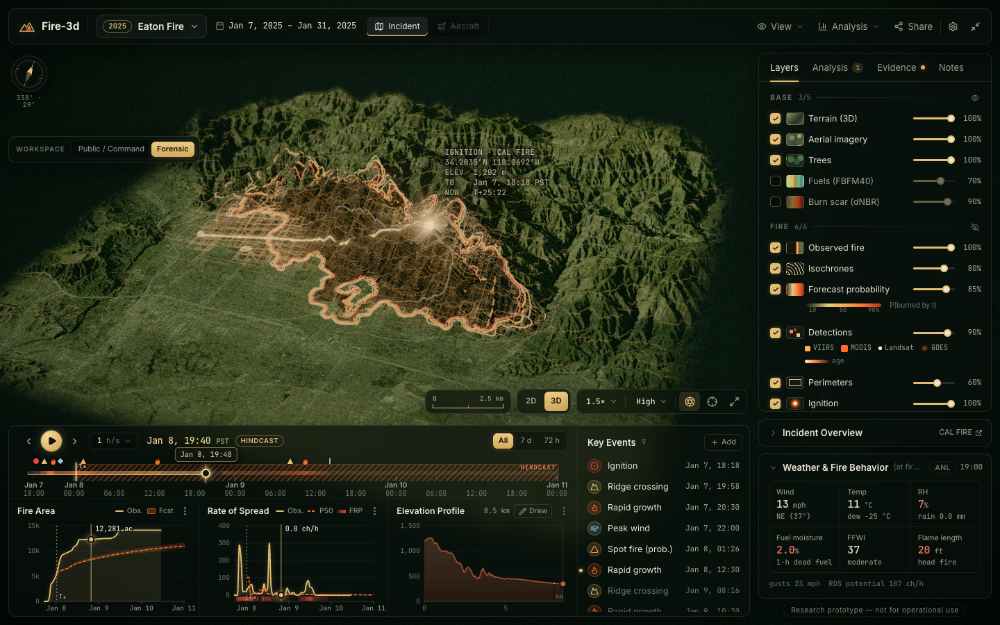
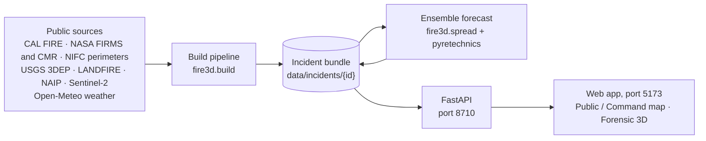
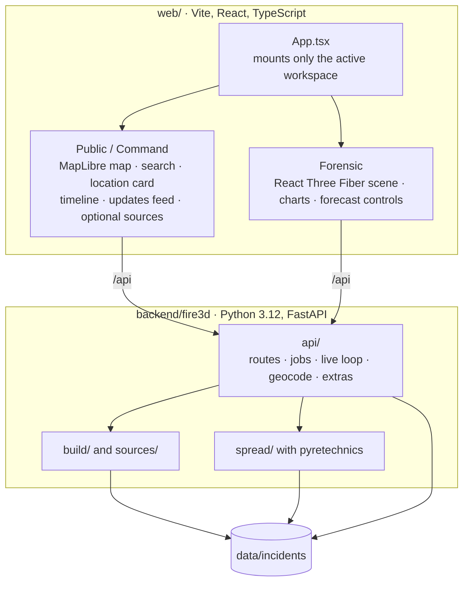

# Fire-3d

**Wildfire forensics and forecast for California, built on real data.**

Fire-3d is a map-first web app that helps you understand a California wildfire: where it is, how it spread, which
nearby places it may reach, and how current and reliable that information is. It combines public data (satellite heat
detections, agency-mapped fire perimeters, elevation, vegetation "fuels" and weather) and runs a physics-based
fire-spread model many times with slightly different weather (an *ensemble*), so it can show how many of those model
runs reached each spot. It covers the fires CAL FIRE currently lists as active and every 2025 California fire of 300
acres or more, which you can replay hour by hour and re-forecast from any past moment to see how well the model would
have done (a *hindcast*). Fire-3d is a **research prototype, not for operational use**.

> [!IMPORTANT]
> Fire-3d's forecasts are experimental model output. They are not evacuation instructions and they are not official
> information. Always follow the orders of local officials and CAL FIRE.

## Screenshots

<!-- verify: swap in the final screenshots (docs/screenshots/redesign-final-*) once ui-integration has taken them.
     The Forensic shot below still shows the old "FFWI 37 moderate" weather label, which has since been replaced by a
     value with an explanation. -->



| Command preset: 3D terrain with aerial photos | Forensic workspace: the 3D analysis scene |
|---|---|
|  |  |

## What you can do

Fire-3d has two workspaces. **Public / Command** is one map of California with the fire drawn on top; its two presets,
Public and Command, share the same map and data. **Forensic** is a 3D analysis scene with the scientific detail.
Switching between them keeps the incident, the timeline time, the forecast and your selected point.

### Public (the default view)

- **See where the fire is** on a continuous map with roads, towns and landmarks: the burned area reconstructed from
  satellite detections and perimeters, agency-mapped perimeters (with the time they were mapped), satellite heat
  detections, and the incident's reported location (CAL FIRE's point, not the exact ignition point).
- **Pick a basemap:** dark, roads, or aerial photos with road and place labels. The aerial photos are dated USGS
  orthoimagery, not live satellite images.
- **Switch between 2D and 3D:** a north-up map, or tilted 3D terrain. If the terrain service is down, the map stays
  usable as a flat map and says so.
- **Read the forecast in plain words.** The modeled spread is shaded by the share of model runs that reached each spot
  ("at least 10 %, 50 % or 90 % of model runs had reached this spot by this time"). The chance of burning is always
  stated for the forecast's whole period, for example "by Jan 11, 00:18 PST, the end of the 72-hour hindcast", never
  as "the next 24 hours". Forecasts show their start and issue times.
- **Check a location.** Type a US street address, paste coordinates (decimal, degrees-minutes-seconds or a map link)
  or click the map; typing a fire's name in the same box opens that fire instead. A card then tells you, in plain
  language:
  - whether the point is inside the latest mapped perimeter (or the satellite-based estimate when there is none), and
    how far away and in which direction the edge is;
  - when the spot burned, and the modeled chance and arrival times;
  - the wind and terrain at the point, and where each number comes from. Each fact carries a tag: Mapped, Observed,
    Estimate, Model, Approximate or Unknown.

  Outside the area the model covers, the card says "unknown, not low risk". Street-address pins are approximate
  (placed along a range of house numbers, not on the rooftop) and you can drag them.
- **Follow the timeline:** past observations (solid line), NOW for live fires, and +24 h / +48 h / +72 h where the
  selected forecast covers them (dashed). Periods without data are disabled, with the reason. Live data older than
  6 hours is flagged STALE, and the current time is shown separately from the latest observation.
- **Read the updates feed:** fire start, rapid growth, ridge crossings, possible spot fires, peak wind, perimeter
  updates, containment and satellite passes, each with its time, source and kind (observation, estimate, model output,
  official update or your own note). Automated items carry an "Automated" label. Clicking an item moves the timeline
  to its time and flies the map to its location.
- **Copy coordinates at any time.** The incident's reported location and your selected point are always shown in WGS84
  latitude and longitude, with copy buttons.
- **Turn on official and public sources** in the Layers panel: <!-- verify: ui-integration mounts these; check them in the final build -->
  - evacuation orders and warnings from local officials via Cal OES, with the official wording, the issuing authority
    and the update time; the location card lists any zone your point is in (current status only, never shown for
    past dates, and "no zones listed" is never an all-clear);
  - public wildfire and traffic cameras (an image loads only when you ask for it);
  - recently acquired satellite images (Sentinel-2, Landsat, VIIRS and GOES-West) with their acquisition time, cloud
    cover and resolution.
- **Use everyday units:** mph, feet, miles, °F and acres by default, metric on request. The three analysis charts (fire
  area, rate of spread and elevation profile) open in an Analysis drawer.
- **Keyboard and phone friendly:** `/` focuses the search box, `H` hides the panels, `Space` plays the timeline and the
  arrow keys step it. Reduced-motion settings are respected. On phones the panels become bottom sheets.

### Command (for emergency managers)

The same map and data, but denser: coordinates also in degrees-minutes-seconds and UTM, the incident ID, timestamps
with years, and a data-status block that lists the newest time of each source (observations, perimeter, last
detection, forecast issue, weather, CAL FIRE record).

### Forensic (the 3D analysis scene)

The original React Three Fiber scene, with all the scientific tools:

- photographic terrain (NAIP aerial photos on USGS elevation) in three visual styles: hybrid, realistic and parametric;
- the observed fire with isochrones (lines of equal arrival time), contours, burn severity (dNBR) and fuels; the
  forecast as a probability field with 10 / 50 / 90 % contours; detections by satellite; perimeters; trees, smoke,
  embers and wind streaks; the golden data lattice (for example the activity or slope lattice) and telemetry labels;
- the full timeline with event markers, Key Events with your own notes, and charts of fire area, rate of spread (in
  chains per hour) and an elevation profile along a path you draw;
- forecast controls: choose a start time, a 24, 48 or 72 h horizon and the weather ensemble, then see the run's
  progress, the P10–P90 area range and, for past fires, the hindcast skill scores;
- Evidence and Notes tabs, a weather and fire-behavior card, and live firefighting aircraft from open ADS-B data (live
  incidents only).

## Quick start

### Prerequisites

- macOS or Linux with a C compiler (on macOS: `xcode-select --install`). The fire-spread engine, pyretechnics, is
  compiled from source when the backend is first installed (about 45 s).
- [uv](https://docs.astral.sh/uv/) (developed with 0.10.3). uv also installs Python 3.12, which the backend requires
  (`requires-python = ">=3.12,<3.13"` in `backend/pyproject.toml`).
- [Node.js](https://nodejs.org/) 22.12 or newer, with npm. `web/package.json` has no `engines` field; the limits come
  from its tools: Vite 8 needs Node `^20.19 || >=22.12`, and the test runner Vitest 5 needs `^22.12 || ^24 || >=26`.
  Fire-3d was developed with Node 25.6.1 and npm 11.9, which work but may print an npm engine warning.
- About 1 GB of free disk for `data/`. Each incident bundle is 10–30 MB, and the shared download cache grows to a few
  hundred MB.
- A browser with WebGL2 (any recent desktop browser). Google Chrome is needed only for the screenshot script.

### Install

```bash
git clone <this repository> Fire-3d && cd Fire-3d
(cd backend && uv sync --frozen)   # creates backend/.venv from uv.lock; compiles pyretechnics the first time
(cd web && npm ci)                  # installs the exact versions in web/package-lock.json
```

### Optional: a NASA FIRMS key

Fire-3d works without any key, using NASA's free download files: Suomi NPP VIIRS and MODIS for 2025 fires, and the
last 7 days of VIIRS and MODIS for live fires. A free NASA FIRMS `MAP_KEY` unlocks the FIRMS area service, which adds
GOES (fire timing to within minutes), Landsat and, for 2025 fires, the NOAA-20 and NOAA-21 VIIRS satellites. Request
one at <https://firms.modaps.eosdis.nasa.gov/api/map_key/> (limit: 5,000 transactions per 10 minutes; Fire-3d
throttles itself to 150 requests per 10 minutes). Then create a file named `.env` in the repository root with your
editor:

```ini
FIRMS_MAP_KEY=<your key>
```

and run `chmod 600 .env`. Only `backend/fire3d/config.py` reads it (a real environment variable of the same name takes
precedence). `.gitignore` already excludes `.env` and `.env.*`, so the key is never committed, and Fire-3d masks it as
`***` in logs and error messages. Never paste the key into code, issues or screenshots.

### Run

```bash
./dev.sh --no-live     # quiet start: API on http://127.0.0.1:8710, web app on http://localhost:5173
```

Open <http://localhost:5173>. `Ctrl-C` stops both servers.

| Command | What it starts |
|---|---|
| `./dev.sh` | the API with the live loop: it refreshes live fires every 15 minutes and, right after startup, auto-builds up to 4 active live fires (at least 100 acres, with detections in the last 48 h), one at a time |
| `./dev.sh --no-live` | the API without the live loop or auto-builds (best for a first look) |
| `./dev.sh --reload` | the API restarts when backend code changes; live auto-build is off, because a restart would kill builds in progress |
| `./dev.sh --fixture` | a small fixture server (`backend/scripts/serve_fixture.py`) that lists and serves only the bundles already on disk, with fake build and forecast jobs and synthetic aircraft; address search and the optional sources need the real API |

Ports: the API uses **8710** and the web app **5173** (Vite's default in `web/vite.config.ts`, which proxies `/api` to
the API). Change them with `API_PORT=… WEB_PORT=… ./dev.sh`. Port 8000 is never used: `dev.sh` refuses it, because
another local app owns it on the development machine. Other settings: `FIRE3D_DATA_DIR` and `FIRE3D_CACHE_DIR` (where
data goes, default `data/` and `data/cache/`), `FIRE3D_LIVE`, `FIRE3D_AUTO_BUILD_LIVE`, `FIRE3D_LIVE_INTERVAL_S`
(backend), and `VITE_API_TARGET` (where Vite sends `/api`).

### The first run: what to expect

- **A fresh clone has no incident data** (`data/` is gitignored). On first open the app selects the 2025 Eaton Fire
  (or the largest live fire that is already built) and, because nothing is built yet, starts building it while a
  progress card shows each step. Picking any other unbuilt fire, from the incident picker (live or 2025 fires) or the
  search box, starts its build too. To build only on request, switch off "Auto-build unbuilt incidents" in Forensic's
  settings menu; a **Build bundle** button then appears instead.
- **A first build takes about 1–3 minutes per fire**, mostly downloads. Measured during development: Eaton 69 s,
  Palisades 75 s, Madre 87 s and Camino 192 s; the live Henderson and Norte fires 57 s and 47 s, including their first
  forecast. The 4,000-pixel aerial photo alone takes about 30 s on a cold cache, and the GOES detections of a long
  past fire can take 1–2 minutes. Rebuilds with a warm cache are much faster.
- **A forecast takes about 2–25 seconds** (31–51 model runs over 72 h, measured on a 12-core laptop).
- **To try it without downloads**, create the two synthetic demo incidents (about 30 s), then open one of them
  directly by its address, so the app does not start building Eaton:

  ```bash
  (cd backend && uv run python scripts/make_fixture.py)
  # then open http://localhost:5173/?incident=fixture-demo   (or ?incident=fixture-live)
  ```

  The app labels them "Demo · simulated data".

Useful address-bar options: `?incident=2025-eaton-fire-dbfa57`, `&preset=command`, `&persp=3d`,
`&basemap=roads` or `&basemap=aerial`, `&units=metric`, and `&ws=forensic` for the Forensic workspace.

### Checks

```bash
(cd backend && uv run pytest -q)    # offline backend tests (about 20 s)
(cd web && npm run typecheck && npm run lint && npm test && npm run build)
(cd web && node scripts/shot.mjs "http://localhost:5173/?incident=fixture-demo" /tmp/fire3d.png --wait 8000)   # screenshot with the installed Chrome
```

## How data flows



1. **Catalog.** CAL FIRE's incident lists give the live fires and the 2025 fires; NASA FIRMS's public 24-hour feeds
   count recent detections near each one.
2. **Build** (`fire3d.build.pipeline`). Fire-3d chooses an *analysis area* around the fire: a square in the fire's UTM
   zone (10 or 11), sized to the fire. It then downloads elevation (USGS 3DEP), fuels and canopy (LANDFIRE), an aerial
   photo (NAIP) and burn severity (Sentinel-2 dNBR). From satellite detections and perimeters it reconstructs when
   each cell burned (an *arrival-time* map), plus hourly burned area and key events. For live fires it also asks
   NASA's catalog of satellite passes (CMR) whether later passes over the fire saw nothing, which sets the latest
   observation. Finally it fetches weather for a 4 × 4 grid of points (Open-Meteo) and, for live fires, runs a first
   forecast.
3. **Bundle.** Everything lands in `data/incidents/<id>/`: `manifest.json`, raw grids (`layers/*.bin`), JSON files
   (detections, perimeters, timeseries, events, weather) and one folder per forecast run (`forecasts/<run_id>/`, with
   arrival-time quantiles, burn probability and flame length). Incident IDs look like `2025-eaton-fire-dbfa57` (year,
   name, and the start of CAL FIRE's ID).
4. **Forecast** (`fire3d.spread`). Many model runs start from the area burned at the start time and spread the fire
   for up to 72 hours (details in [the forecast section](#the-forecast-model-and-how-good-it-is)). For past fires
   Fire-3d also scores the forecast against what actually burned.
5. **API.** FastAPI serves incident lists, bundle files and build or forecast jobs. With the live loop on, every 15
   minutes it copies CAL FIRE's latest acres, containment and status into each live fire; when there are new
   detections, or every 3 hours, it also refreshes the observations and weather and re-runs the forecast if needed.
6. **Web app.** The Public / Command map reprojects the UTM grids pixel by pixel into the web map's projection and draws
   them below the road and place labels; Forensic draws the same arrays in 3D.

Conventions: JSON times are UTC epoch milliseconds (fields end in `_ms`) and the app displays Pacific time; grid row 0
is the north edge; wind directions are the direction the wind blows **from**. The data contracts are in
[SPEC.md](SPEC.md) (sections 4–6).

### Command line

Run these from `backend/`:

```bash
uv run python -m fire3d.cli catalog --mode live                          # list incidents (--mode historical --min-acres 100)
uv run python -m fire3d.cli build eaton                                  # build a bundle by name or ID (--force rebuilds)
uv run python -m fire3d.cli forecast <id> --horizon 72 --ensemble auto   # optional: --start ISO, --members N
uv run python -m fire3d.cli hindcast <id> --start 2025-01-08T08:18:00Z --ensemble perturbed   # prints the skill scores
uv run python -m fire3d.cli serve --port 8710 --no-live                  # the API alone (also --reload, --live, --auto-build)
```

`--ensemble` accepts `auto` (live fires: `gfs025`; past fires: `perturbed`), `gfs025` (31 GFS members),
`ecmwf_ifs025` (51 ECMWF members), `perturbed` (31 runs around the archived weather) or `none` (a single run). The real
GFS and ECMWF ensembles only cover about the last 90 days, so past fires use `perturbed`.

Helper scripts, also from `backend/`:

| Script | Purpose |
|---|---|
| `uv run python scripts/make_fixture.py [--only demo\|live]` | write the two synthetic demo bundles |
| `uv run python scripts/serve_fixture.py --port 8710` | serve bundles from disk without the full backend |
| `uv run python scripts/check_bundle.py <id> [--quicklook DIR]` | check a bundle against the data contract; optional quick-look images |
| `uv run python -m fire3d.spread.validate hindcast …` or `… live-start …` | batch hindcasts for calibration, or the check of the live start on past fires (see [docs/validation.md](docs/validation.md), section 9) |

<details>
<summary>HTTP API</summary>

| Method | Path | Returns |
|---|---|---|
| GET | `/api/health` | `{ok, version}` |
| GET | `/api/incidents?mode=live\|historical&min_acres=300` | incident list |
| GET | `/api/incidents/{id}` | summary, manifest and current job |
| POST | `/api/incidents/{id}/build?force=false` | a build job |
| POST | `/api/incidents/{id}/forecast` | a forecast job (body: `start_ms`, `horizon_h`, `ensemble`, `members`, all optional) |
| GET | `/api/jobs/{job_id}` | job status and progress |
| GET | `/api/bundles/{id}/{path}` | bundle files (gzip, ETag) |
| GET | `/api/incidents/{id}/aircraft` | firefighting aircraft near a live fire |
| GET | `/api/live/status` | live-loop status |
| GET | `/api/geocode?q=<US street address>` | Census Geocoder matches (cached 30 days) |
| GET | `/api/extras/{evacuations,cameras,cameras/latest,imagery,sources}` | optional sources (`?incident=<id>` or `?bbox=w,s,e,n`; a camera image needs `?id=<camera id>`) |

</details>

## Architecture



**Backend** (`backend/fire3d/`):

| Module | Role |
|---|---|
| `config.py`, `http.py` | settings, environment variables, the FIRMS key and secret masking; a cached HTTP client with retries, a concurrency cap and the FIRMS rate limiter |
| `grid.py`, `bundle.py`, `contracts.py`, `types.py`, `timeutil.py` | analysis-area math, bundle reading and writing (atomic, locked), data contracts |
| `sources/` | one module per provider: `calfire`, `firms`, `overpass` (NASA CMR satellite passes), `perimeters`, `terrain` (3DEP), `landfire`, `imagery` (NAIP), `sentinel` (dNBR), `weather` (Open-Meteo), `aircraft` (adsb.lol, adsb.fi fallback) |
| `catalog.py` | live and 2025 incident lists |
| `build/` | `pipeline` (the build sequence), `aoi` (terrain, fuels, imagery, trees, burn scar), `observed` (spread reconstruction), `live_observation` (the latest observation of a live fire), `weather_bundle` |
| `spread/` | `moisture` (fuel moisture, fire weather index), `behavior`, `engine` (pyretechnics runs), `ensemble` (forecasts), `validate` (scores and calibration) |
| `api/` | `app` (routes), `jobs` (build and forecast queue), `live` (refresh loop), `geocode` (Census proxy), `extras` (evacuation zones, cameras, recent imagery) |
| `cli.py` | the command line above |

**Web app** (`web/src/`):

| Folder | Role |
|---|---|
| `state/` | two zustand stores: `store.ts` (incident, live or past data, forecast run, timeline) and `workspace.ts` (workspace, preset, 2D/3D, basemap, units, selected point, map view) |
| `api/` | typed API client |
| `map/` | the MapLibre map: basemaps, terrain, reprojected fire overlays, vector layers, controls, legend and credits |
| `location/` | search, location checks and the coordinate strip |
| `ui/shell/`, `ui/timeline/`, `ui/feed/` | the map workspace layout (header, panels, drawers, safe area, workspace switching), the compact timeline and the updates feed |
| `extras/` | optional sources: evacuation zones, cameras, recent satellite imagery |
| `scene/` and the other `ui/` files | the Forensic workspace: 3D scene, effects, panels, full timeline, charts, Key Events |
| `lib/`, `data/` | geodesy, UTM reprojection, plain-language wording, raster loading |

**The two workspaces.** `App.tsx` mounts only the active workspace, so the hidden one does not render in the
background. In Public / Command, MapLibre GL JS owns the camera, terrain and tiles, and the fire grids are drawn as
reprojected image overlays draped on the terrain. Forensic keeps its own Three.js renderer. When you switch, the camera
is handed over so you keep looking at the same place.

Design documents: [SPEC.md](SPEC.md) (data contracts and HTTP API), [docs/redesign/BRIEF.md](docs/redesign/BRIEF.md)
(the map-first redesign), [docs/redesign/CONTRACT.md](docs/redesign/CONTRACT.md) (interfaces between the parts),
[docs/validation.md](docs/validation.md) (forecast validation), [PLAN.md](PLAN.md) and
[docs/dev/module-reports.md](docs/dev/module-reports.md) (build notes).

## The forecast model and how good it is

### What the model does

Each forecast runs the open-source fire model [pyretechnics](https://github.com/pyregence/pyretechnics) (Rothermel
surface-fire spread, Van Wagner crown fire, level-set front tracking) on the analysis area, a grid of up to 512 × 512
cells of about 30–100 m. Its inputs are LANDFIRE fuels and canopy, slope and aspect from USGS elevation, and hourly
wind, temperature and humidity. Each run starts from the area that had already burned at the start time.

- **Past fires:** 31 runs around archived HRRR weather, each with slightly changed wind speed and direction, humidity
  and temperature.
- **Live fires:** the 31 GFS or 51 ECMWF ensemble members from Open-Meteo, adjusted to the HRRR model while HRRR data
  exist.

Fire-3d summarizes the runs in two ways:

- **Burn probability:** the share of runs that burned a cell by the end of the forecast (72 hours by default). It
  describes the model ensemble, not real-world odds, and it always covers the whole forecast period.
- **Arrival-time quantiles P10, P50 and P90:** the times by which at least 10 %, 50 % and 90 % of the runs had reached a
  cell. They are not scenarios, and P90 is not a "worst case".

Three calibrated settings are on by default ([docs/validation.md](docs/validation.md), sections 3 and 5):

1. **Drought-adjusted live fuel moisture.** After a dry winter the vegetation is treated as drier than the monthly
   table says. (Eaton had only 12 mm of rain since October.)
2. **Held quiet perimeter.** Edges with no growth and no satellite detection of new burning within 1 km in the
   12 hours before the start do not spread. A detection counts as spread only where it coincides with growth: hot
   pixels on ground that burned more than 12 hours earlier are burnout, not spread.
3. **A spread-rate multiplier that shrinks with lead time:** 0.5 × (0.1 + 0.9 × e^(−lead / 12 h)), which is 0.22 at
   12 h, 0.11 at 24 h and 0.05 at 72 h. It stands in for things the model lacks, such as firefighting and fires dying
   down after a wind event.

### How it was tested

Three 2025 fires (Eaton, Madre and Palisades) were re-forecast from 8 past start times and compared at 12, 24, 48 and
72 hours with the spread reconstructed from satellite detections and perimeters: 32 comparisons in all. The score is
the **growth-only Sørensen score**: the overlap between the forecast (P50) area and the observed area that burned
*after* the start, from 0 (no overlap) to 1 (a perfect match).

| Configuration | Mean of 32 | Eaton | Madre | Palisades | +12 h | +24 h | +48 h | +72 h |
|---|---:|---:|---:|---:|---:|---:|---:|---:|
| Model as first specified (monthly fuel-moisture table, constant multiplier), single run | 0.390 | 0.429 | 0.207 | 0.473 | 0.274 | 0.402 | 0.451 | 0.434 |
| Current settings, single run | 0.432 | 0.432 | 0.392 | 0.458 | – | – | – | – |
| Current settings, 31-run ensemble | 0.438 | 0.438 | 0.395 | 0.467 | 0.349 | 0.432 | 0.481 | 0.490 |

docs/validation.md gives no per-lead values for the current single run. The burnout rule (see the held perimeter
above, added on Oct 18, 2026) raised the single-run score from 0.422 to 0.432 and the ensemble score from 0.428 to
0.438, all through Madre, which was forecast after its main run (single run 0.353 → 0.392); Eaton and Palisades did
not change. A total-area score, which also counts the area already burned at the start, averages about 0.82, but that
number looks good mainly because the starting area always overlaps. The past-fire hindcasts stored in the app's
bundles were made before the burnout rule and were not re-made: Eaton's and Palisades' are unaffected, and Madre's
would improve.

### What the scores mean

- **Skill is moderate.** Use the forecast as experimental guidance about direction and reach, not as a prediction of
  exact lines.
- **Too much growth late in a fire.** After the main wind-driven run ends, the model keeps spreading. In the median,
  the forecast grows about 1.85 times as much as the real fire. The published Madre hindcast, started after its main
  run, grew 2.1–2.5 times as much as the fire did.
- **Too little growth at the start of extreme runs.** Started 6 hours after ignition, the Eaton forecast grew 1,966
  acres in the next 12 hours, while the fire grew 6,204 (about 30 %); Palisades grew 2,967 against 11,778 (25 %). Part
  of that early "observed" growth is satellite overestimation ("VIIRS bloat") around small, very hot fires, and part is
  burning through neighborhoods, which the model cannot do.
- **Wind and slope work as expected.** Unit tests and a check on Eaton confirm that modeled fire runs downwind and
  uphill. On Eaton the default model still grew mostly north into the mountains, because the neighborhoods downwind
  are coded as non-burnable; the real fire went west and northwest.

### What is not modeled

- **Firefighting, including the initial attack that stops many small fires early.** The shrinking multiplier and the
  held perimeter imitate some of this statistically, and for live fires at least CAL FIRE's contained share of the
  perimeter is held.
- **Fire spreading through neighborhoods.** LANDFIRE marks developed land as non-burnable, so the urban burning in
  Altadena and Pacific Palisades cannot be reproduced. A tested option that lets developed land near wildland burn
  lowered the scores and is off.
- **Ember spotting.** With untuned parameters it produced about 15 times too much growth, so it is off.
- **Fuel and model uncertainty.** The runs differ only in weather, so the P10–P90 range is too narrow (about 2–4 % of
  the burned area for live forecasts).
- **Fire beyond the analysis area.** Probabilities near the edge are underestimated; forecasts warn when runs reach the
  edge.
- **Terrain-scale winds.** The weather models have 3–25 km cells, so ridge and valley winds are smoothed out.

### Caveats on the scores

- The hindcasts used almost perfect weather (archived short-range HRRR forecasts). Real-time forecasts will do worse.
- Only three fires were used, two of them in the same Santa Ana wind event, and all in chaparral and grass. The
  settings may not transfer to timber or other fire regimes.
- The shrinking multiplier will under-predict a new wind event two or three days after the start.
- The "observed" spread is itself a reconstruction: on a synthetic test its median timing error was 1.29 hours.

### Live forecasts

Live forecasts start at the **latest observation** of the fire: its newest satellite detection or mapped perimeter,
or a later satellite pass that looked at the fire and saw no new fire (checked against NASA's catalog of VIIRS and
MODIS passes). The burned area is never grown past the last detection or mapped perimeter. Any part of the perimeter
that stayed quiet for the 12 hours before the start is held, and so is at least CAL FIRE's contained share. A fully held
perimeter means no modeled growth, not that the fire is out. If CAL FIRE reports more than 1.25 times the mapped area
plus 100 acres after the last detection (the fire may have grown unseen under cloud or smoke), or NASA's pass catalog
cannot be reached, the forecast starts at the last detection instead, with a warning.

Example, Oct 17, 2026: the Henderson Fire's old forecast started at its last detection (Oct 16, 14:48 PDT) and
predicted about 13,000 acres for that evening. The new one starts at the latest pass (Oct 17, 15:50 PDT; 13 passes in
between saw no fire) and holds 3,228 acres; CAL FIRE reported 3,160 acres, 50 % contained.

Live forecasts cannot be scored yet. Instead, [docs/validation.md](docs/validation.md) section 6 re-issues past fires
as if they were live. In the 14 cases where the fire had gone quiet, the new start raised the total Sørensen score
from 0.36 to 0.67 and cut the median growth ratio from 86 to 2.6 times the observed growth; it does not affect
historical hindcasts. The sample is small and mostly one fire (9 of the 14 cases are the Lidia Fire).

**Still over-predicted: small fires that crews stop early.** The model has no suppression or initial attack; besides
the statistical settings above, only CAL FIRE's containment minimum (live fires only) partly stands in for it. In the
re-issued forecasts made after they had gone quiet, the small Lidia and Camino fires (both stayed under 400 acres)
show a mean growth error of about 1,450 acres against about 50 acres of observed growth, most likely spread from
edges that crews had already stopped. The archive cannot test a small fire
that is still actively burning: of 33 re-issued small-fire forecasts (every 2 hours), only one started while the fire
was active (Camino: 1,696 acres of forecast growth, none observed).

Always check a forecast's start and issue times. Its details list its warnings: where it starts and why, the
multiplier schedule, the share of the perimeter held and the live fuel moisture used. A forecast takes about 2–25
seconds. To reproduce the numbers, see [docs/validation.md, section 9](docs/validation.md#9-reproduce).

## Limitations

- **California only.** Past fires are the 2025 CAL FIRE list (300 acres or more, or 100 with the toggle); live fires
  are what CAL FIRE lists as active.
- **Fixed analysis area.** Each fire's model area is set when it is built. Panning beyond it shows "Outside modeled
  area", which means unknown, not low risk.
- **Coarse observations.** Satellite detections are 375 m (VIIRS), 1 km (MODIS) or 2–3 km (GOES) across, with a few
  polar-orbiting passes a day. The replay is interpolated between them. 27 of the 78 past fires of 300 acres or
  more have no agency perimeter, so they rely on detections alone, and perimeter times are best estimates.
- **"No fire seen" has limits.** A satellite pass only rules out fire above its detection limit: thick cloud, smoke or
  smoldering can hide a burning fire. Passes are looked up at the fire's center, so a very large fire can lie partly
  outside a pass. A live forecast's start moves forward only when its bundle refreshes (new detections, or every
  3 hours for a quiet fire), so it can trail the newest pass by a few hours.
- **Address search** finds US street addresses with house numbers only (no place names or points of interest), and
  the pins are approximate.
- **Evacuation data** is current status only, and only as complete as the counties that feed the Cal OES layer.
- **Aircraft:** news or police helicopters that broadcast no callsign can be mistaken for firefighting aircraft flying
  low and slow over the fire.
- **Free public map services** (OpenFreeMap, Mapterhorn, USGS) have no service-level guarantee.
- **Local only.** There is no deployment, user accounts or authentication.
- **Known advisory:** maplibre-gl 5.24.0 carries advisory GHSA-jrc7-96c5-q579 (a cross-site scripting bypass in the
  sanitizer behind MapLibre's built-in attribution control). Fire-3d keeps that control off and renders credits and
  pop-ups as plain text, so the vulnerable code never runs. Upgrading to MapLibre 6.5 or newer would remove it.

## Troubleshooting

| Problem | What to do |
|---|---|
| `dev.sh` or Vite says a port is in use | Pick other ports: `API_PORT=8720 WEB_PORT=5174 ./dev.sh`. Vite uses a strict port, so it stops instead of picking another. Never use 8000. |
| The app shows errors or no incidents | Check the API: `curl http://127.0.0.1:8710/api/health` should return `{"ok": true, …}`. If you run the servers separately, set `VITE_API_TARGET`. |
| No FIRMS key | Builds still work with NASA's keyless files (see [the FIRMS key section](#optional-a-nasa-firms-key)), without GOES timing or Landsat. The bundle's warnings then include "FIRMS: no FIRMS_MAP_KEY: keyless feeds only". Add the key to `.env` and rebuild with `build <id> --force`. |
| Builds are slow | Large past fires need many FIRMS requests; Fire-3d waits for its rate limiter instead of failing. Use `./dev.sh --no-live` so live auto-builds do not compete. |
| Aircraft are missing or slow to appear | Aircraft are tracked for live fires only, in Forensic. When adsb.lol cannot be reached, Fire-3d falls back to adsb.fi automatically; the first request after each 5-minute retry window can wait about 17 seconds for the timeout. |
| The map says "Street map unavailable", "3D terrain unavailable … showing a flat map" or "Aerial imagery unavailable" | That map service is down. The fire layers keep working. Try another basemap, or point `VITE_OPENFREEMAP_STYLE_BASE`, `VITE_MAPTERHORN_TILEJSON` or `VITE_USGS_IMAGERY_SERVICE` at another server. |
| An optional source says "unavailable" | The official source did not answer; the panel gives the reason. Fire-3d never fills in invented data. |
| A build ends with an error | A required step failed, for example the CAL FIRE list, USGS elevation, LANDFIRE fuels or Open-Meteo weather. The message says which; retry later from the app or with `build <id> --force`. If CAL FIRE is down, its last cached list is used. Optional parts (aerial photo, burn severity, trees) only add a warning. |
| `uv sync` fails while building pyretechnics | Install a C compiler (on macOS: `xcode-select --install`) and run it again. |
| Live data is marked STALE | The newest observation is more than 6 hours old. It means "check the time", not "the fire is out". |
| A live forecast shows no growth | Its whole perimeter is held: satellites saw no new fire near it for 12 hours or more, or CAL FIRE reports it fully contained. That means no modeled growth, not that the fire is out; check official sources. |
| The Forensic scene stays blank | It needs WebGL2. Check that hardware acceleration is turned on in your browser. |

## Data sources, licenses and credits

Fire-3d uses only free public data and services. Each keeps its own terms; follow the credit and use rules below if
you share or publish anything made with Fire-3d.

> [!WARNING]
> **Some sources are for non-commercial use only:** Open-Meteo's free API, adsb.fi and ALERTCalifornia camera images
> (CC BY-NC-ND 4.0). Newer pyretechnics releases may also be non-commercial (see below). Commercial use would need an
> Open-Meteo API subscription, permission from adsb.fi, a license from UC San Diego for ALERTCalifornia, and a check
> of the pyretechnics license, or those features turned off.

### Fire, terrain and weather data

| Source | Used for | License and terms | Credit |
|---|---|---|---|
| [CAL FIRE incidents](https://www.fire.ca.gov/incidents) | incident lists, reported location, acres, containment | public website data; no separate license found <!-- verify: fire.ca.gov returned 403 to automated checks, so CAL FIRE's conditions of use could not be read --> | CAL FIRE |
| [NASA FIRMS](https://www.earthdata.nasa.gov/data/tools/firms) | satellite fire detections (VIIRS, MODIS, GOES, Landsat) | NASA open data, [no restrictions on use](https://www.earthdata.nasa.gov/engage/open-data-services-software-policies/data-use-guidance); optional free [MAP_KEY](https://firms.modaps.eosdis.nasa.gov/api/map_key/) | "We acknowledge the use of data and/or imagery from NASA's Fire Information for Resource Management System (FIRMS), part of NASA's Land, Atmosphere Near real-time Capability for Earth observations (LANCE) and NASA's Earth Science Data and Information System (ESDIS)." |
| [NASA CMR](https://cmr.earthdata.nasa.gov/search/site/docs/search/api.html) (Common Metadata Repository) | times of the VIIRS and MODIS passes over a live fire, which set where its forecast starts; pass times for recent imagery | NASA open data, no key, [no restrictions on use](https://www.earthdata.nasa.gov/engage/open-data-services-software-policies/data-use-guidance) | NASA Earthdata (CMR) |
| [NIFC WFIGS perimeters](https://data-nifc.opendata.arcgis.com/) | agency-mapped fire perimeters | open federal interagency data, no login; the service publishes no license text <!-- verify: WFIGS license; the layer metadata has an empty copyright field --> | Wildland Fire Interagency Geospatial Services (WFIGS) Group, NIFC |
| [USGS 3DEP](https://www.usgs.gov/3d-elevation-program) | elevation for the model and the Forensic terrain | U.S. public domain ([USGS copyrights and credits](https://www.usgs.gov/information-policies-and-instructions/copyrights-and-credits)) | U.S. Geological Survey |
| [LANDFIRE](https://landfire.gov/) (LF2024, LF2025) | fuels and canopy for the model | U.S. public domain, no use constraints (USGS metadata) <!-- verify: LANDFIRE's own site states no license; public domain per the USGS data catalog --> | cite as on [landfire.gov/data/citation](https://landfire.gov/data/citation) |
| [NAIP](https://naip-usdaonline.hub.arcgis.com/) (USDA), served by [The National Map](https://imagery.nationalmap.gov/arcgis/rest/services/USGSNAIPImagery/ImageServer) | aerial photo in Forensic, water mask | U.S. public domain, credit requested ([USDA FSA policy](https://www.fsa.usda.gov/help/policies-and-links)) | USGS, USDA, The National Map: Orthoimagery |
| [Sentinel-2 L2A](https://registry.opendata.aws/sentinel-2-l2a-cogs/) via [Element 84 Earth Search](https://www.element84.com/earth-search/) | burn severity (dNBR); recent images | [Copernicus Sentinel data legal notice](https://sentinels.copernicus.eu/documents/247904/690755/Sentinel_Data_Legal_Notice): free, full and open access, modification allowed | "Contains modified Copernicus Sentinel data <year>" |
| [Open-Meteo](https://open-meteo.com/) | weather: HRRR, GFS and ECMWF ensembles, archived forecasts, ERA5 | data [CC BY 4.0](https://open-meteo.com/en/licence); the free API is for **non-commercial use only**, under 10,000 calls a day ([terms](https://open-meteo.com/en/terms)) | "Weather data by Open-Meteo.com", linked to open-meteo.com |

### Map, search and aircraft

| Source | Used for | License and terms | Credit |
|---|---|---|---|
| [OpenFreeMap](https://openfreemap.org/) | dark and roads basemaps, labels | free, commercial use allowed, no service-level guarantee ([terms of service](https://openfreemap.org/tos/)) | OpenFreeMap |
| [OpenMapTiles](https://openmaptiles.org/) | vector tile schema and style design | design [CC BY 4.0, code BSD-3-Clause](https://github.com/openmaptiles/openmaptiles/blob/master/LICENSE.md) | © OpenMapTiles |
| [OpenStreetMap](https://www.openstreetmap.org/copyright) | roads, places and labels | [ODbL 1.0](https://www.openstreetmap.org/copyright) | © OpenStreetMap contributors |
| [Mapterhorn](https://mapterhorn.com/) | 3D terrain and hillshade | code BSD-3-Clause; tiles built from open data, listed on its [attribution page](https://mapterhorn.com/attribution/). In California: USGS 3DEP (public domain) and Copernicus GLO-30 (Copernicus free and open license) | © Mapterhorn; U.S. Geological Survey; Copernicus GLO-30: © DLR e.V. 2010–2014 and © Airbus Defence and Space GmbH 2014–2018, provided under COPERNICUS by the European Union and ESA |
| [USGS Imagery Only](https://basemap.nationalmap.gov/arcgis/rest/services/USGSImageryOnly/MapServer) | aerial basemap (dated photos, not live) | U.S. public domain ([USGS](https://www.usgs.gov/information-policies-and-instructions/copyrights-and-credits)) | USDA, USGS The National Map: Orthoimagery |
| [MapLibre GL JS](https://maplibre.org/) 5.24.0 | map renderer | [BSD-3-Clause](https://github.com/maplibre/maplibre-gl-js/blob/main/LICENSE.txt) | MapLibre |
| [US Census Geocoder](https://geocoding.geo.census.gov/geocoder/Geocoding_Services_API.html) | street-address search (`Public_AR_Current` benchmark) | free U.S. government service, no key; no separate terms page | U.S. Census Bureau |
| [adsb.lol](https://www.adsb.lol/docs/open-data/api/) | live aircraft positions | ODbL 1.0 | adsb.lol |
| [adsb.fi](https://github.com/adsbfi/opendata) | aircraft fallback when adsb.lol cannot be reached | **personal, non-commercial use only**; about 1 request per second | adsb.fi, with a link to its home page |

### Optional official and public sources

| Source | Used for | License and terms | Credit |
|---|---|---|---|
| [Cal OES California Evacuation Aggregation Layer](https://data.ca.gov/dataset/california-evacuation-aggregation-layer) (with the County Evacuation Inventory) | official evacuation zones | public, "No restrictions on public use"; Cal OES disclaimer: "This information is constantly changing, and Cal OES does not verify or certify the information contained herein." | Evacuation zones: local officials via Cal OES |
| [Cal OES California Webcams](https://www.arcgis.com/home/item.html?id=5b4040338d704693994d5682ab2747c5) | camera locations | public use | Cal OES California Webcams |
| [ALERTCalifornia](https://alertcalifornia.org/terms/) (UC San Diego) | wildfire camera images | **CC BY-NC-ND 4.0: non-commercial, no derivatives**; never crop the information bar or partner logos ([crediting rules](https://alertcalifornia.org/crediting-and-branding/)) | ALERTCalifornia \| UC San Diego, with every image |
| [Caltrans CCTV](https://cwwp2.dot.ca.gov/documentation/cctv/cctv.htm) | traffic camera images | no charge; public domain ([conditions of use](https://dot.ca.gov/conditions-of-use)) | Caltrans |
| [NASA GIBS](https://www.earthdata.nasa.gov/engage/open-data-services-software/earthdata-developer-portal/gibs-api) | Landsat (HLS), VIIRS and GOES-West image tiles (their pass times come from NASA CMR, above) | NASA open data, [no restrictions on use](https://www.earthdata.nasa.gov/engage/open-data-services-software-policies/data-use-guidance); GOES is NOAA public domain | the product's credit plus "NASA GIBS (ESDIS)" and the GIBS acknowledgement |
| [Element 84 Earth Search](https://www.element84.com/earth-search/) | Sentinel-2 scene search | free public STAC API; the images follow the Copernicus terms above | Earth Search by Element 84 |

### Software

- **[pyretechnics](https://pypi.org/project/pyretechnics/2026.8.10/) 2026.8.10** (the fire-spread engine, Spatial
  Informatics Group) is pinned in `backend/pyproject.toml` and is released under the **Eclipse Public License 2.0**
  (stated on its PyPI page and in the license file of the installed package). The project's GitHub `main` branch now
  carries a different [dual license](https://github.com/pyregence/pyretechnics/blob/main/LICENSE.md): a no-fee
  "Community License" for non-commercial use and a paid commercial license. Check the license before upgrading.
- The other dependencies (React, Three.js, FastAPI, rasterio and so on) keep their own open-source licenses; see
  `web/package.json` and `backend/pyproject.toml`.
- Fire-3d's own code has no license file yet.
